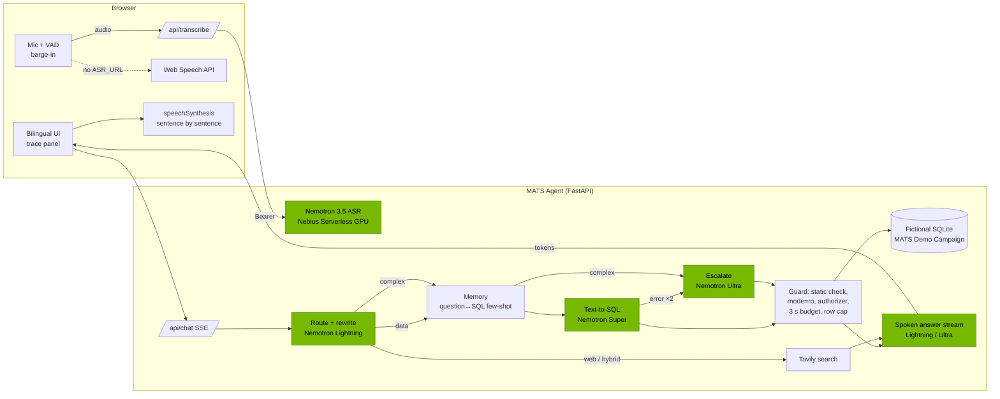

# MATS Agent

**A bilingual (Arabic / English) real-time voice agent for Hajj campaign operations, powered by NVIDIA Nemotron on Nebius Token Factory.**

Submitted to the **Nebius × NVIDIA Global AI Hackathon**, track **Best Apps and Agents**.

> All data in this repository and in the demo is **fictional**. It is generated by
> `data/generate_mock_data.py` for an imaginary "MATS Demo Campaign". No real pilgrim data is used anywhere.

---

## The problem

During the Hajj, a campaign operations room moves thousands of pilgrims between Makkah, Mina, Arafat and Muzdalifah in a few hours. Supervisors stand in the street, on the phone, often with one free hand. They need answers to questions like these straight away:

- "مين ما ركب باص منى لعرفات؟" ("Who hasn't boarded the Mina → Arafat bus?")
- "وش وضع باصات فوج ٥؟" ("What's the status of group 5's buses?")
- "Which buses are delayed, and what should we do about it?"

The answers are in a database, but supervisors can't write SQL, and they speak Saudi dialect, not formal Arabic. Many of the staff speak English.

## What it does

- **Talk to your data.** Press the mic (or turn on *Hands-free*) and ask in Saudi dialect or English. The agent answers out loud in at most three short sentences, in the same language you used.
- **Real-time conversation.** Voice activity detection ends your turn after about 900 ms of silence. In hands-free mode it listens again after replying. **Barge-in** works too: start talking while it speaks, and it stops the speech, cancels the stream and listens.
- **Understands context, whatever it is.** Follow-ups ("وفوج ٥؟", "and group 9?"), pronouns and references to earlier answers ("وش رقم جوال أول واحد؟" = "the first one's phone?", "ومين مشرف فوجه؟" = "and who supervises his group?") are resolved against the conversation *and the data behind earlier answers*.
- **Remembers you.** Say "أنا مشرف فوج 14" ("I supervise group 14") once, and later "وش وضع فوجي؟" ("how's my group?") means group 14, even after a page reload. Facts are kept per browser, are shown in the Runtime panel, and can be forgotten with one click.
- **Learns from its mistakes.** When a query fails and is repaired, or you press **Wrong**, the mistake and its fix are stored as a *lesson*. Similar questions later get the lesson in the prompt, so it doesn't repeat it.
- **Asks when it isn't sure.** If a key detail is missing, it asks instead of guessing. For "وش وضع باصات فوج 5؟" it asks "تقصد من وين لوين؟" ("from where to where?") and offers tappable options; answer by voice or tap. It never guesses "my group" when nothing is remembered.
- **Shows its work.** Every answer comes with the SQL it ran, the result table, and a **"How it answered"** trace: route → memory → SQL → guard → answer, with the Nemotron model and milliseconds for each step, plus the total latency.
- **Learns.** Successful question→SQL pairs are stored and retrieved as few-shot examples. **Right** marks a pair as verified; **Wrong** makes the agent forget it.
- **Knows what's happening outside.** Weather, traffic and official announcements come from **Tavily**, merged with database results, with sources shown.
- **Read-only by construction.** It has three independent safety layers; see [Safety](#safety-read-only-three-layers).

## NVIDIA Nemotron model routing

Every LLM call is a runtime call to **Nebius Token Factory** (OpenAI-compatible API, `https://api.tokenfactory.nebius.com/v1`). Model IDs live in environment variables. Run `python scripts/check_models.py` to list the Nemotron models on your account and ping the configured ones.

| Step | Model (env var) | Why this model |
|---|---|---|
| Intent routing (`smalltalk / data / complex / web / hybrid / clarify`) + follow-up rewriting + "remember this" detection | `nvidia/Nemotron-3_5-Lightning` (`MODEL_FAST`), fallback `nvidia/NVIDIA-Nemotron-3-Nano-30B-A3B` (`MODEL_FAST_FALLBACK`) | One small JSON call that has to finish in well under a second |
| Routing that needs reasoning: references to earlier rows ("أول واحد", "فوجه"), remembered facts ("فوجي"), and deciding whether to ask a clarifying question | `nvidia/nemotron-3-super-120b-a12b` (`MODEL_ROUTER_REASONING`); falls back to Lightning after 10 s | Lightning tended to copy example values or answer instead of route; Super resolved every case we tried in ~1 s |
| Streamed spoken answer | `MODEL_FAST` | Lowest time-to-first-token, so speech starts while it's still generating |
| Text-to-SQL, with error-feedback repair (2 attempts) | `nvidia/nemotron-3-super-120b-a12b` (`MODEL_SQL`) | Strong structured reasoning at a reasonable latency |
| Complex questions (comparisons, rankings, recommendations): SQL **and** answer | `nvidia/Nemotron-3-Ultra-550b-a55b` (`MODEL_COMPLEX`) | Best reasoning, used only where it pays off |
| Escalation when Super fails twice | `MODEL_COMPLEX` | Ultra gets the failing SQL and the SQLite error |
| Speech-to-text | `nvidia/nemotron-3.5-asr-streaming-0.6b` (`ASR_MODEL`), self-hosted on a Nebius Serverless Endpoint | Supports Arabic; NVIDIA fine-tuned it on SDAIA's SADA dataset for Najdi/Hijazi speech |

`<think>…</think>` reasoning traces are stripped from every output, including across stream chunks (`app/llm.py: ThinkFilter`). If a primary fast model is unavailable, the client falls back automatically, and the trace shows which model actually answered.

**Where Token Factory helped:**
- One OpenAI-compatible endpoint gave us three Nemotron sizes, so routing is just changing a model string per step.
- Ultra-class reasoning at 550B parameters with no infrastructure on our side.
- Fast enough streaming for a spoken conversation.
- Swapping models for evaluation took an environment variable, not a redeploy.

## Architecture



Green nodes are NVIDIA Nemotron models. All LLM calls go to Nebius Token Factory, and ASR runs on a Nebius Serverless GPU endpoint.

## Scope: pilgrim guidance only

MATS Agent answers only what it was built for: pilgrim guidance and the campaign's Hajj operations, plus live conditions at the holy sites. Everything else is declined politely, with a pointer to what it can do. That includes general knowledge, coding, sports, other cities' weather and jokes. Declines happen before any SQL, web search or answer model runs.

- **Religious rulings** ("وش حكم…؟", fatwas) are referred to the campaign's religious guide or the official authorities, never answered by a model.
- **Web search is hard-limited** to the holy sites and Hajj (a check in code on top of the router). A web question that also mentions the campaign's groups, buses or pilgrims is always answered from the database too.
- **"Who are you?"** has a fixed answer (MATS Agent), so the base model never introduces itself instead.
- **Answers never add names or numbers that aren't in the result rows.** We caught the fast model inventing pilgrim numbers for a count-only result, and fixed the prompt rule that invited it.

## Voice

- **Speech-to-text:** Nemotron 3.5 ASR on a Nebius Serverless GPU endpoint (`ASR_URL`), or the browser's Web Speech API.
- **Spoken replies** (`TTS_PROVIDER`), streamed sentence by sentence with the next sentence prefetched while the current one plays:
  - `browser` (default): the best voice the browser has. Voices are ranked: Natural/Neural > Premium/Enhanced/Siri > Google, preferring `ar-SA`. In Microsoft Edge this picks the Saudi neural voices.
  - `edge`: neural voices streamed from the server, including Saudi Arabic **Hamed** and **Zariyah**.
  - `openai`: any OpenAI-compatible `/v1/audio/speech` endpoint (`TTS_URL`), e.g. a self-hosted NVIDIA Magpie TTS for English.

  Voices can be picked and previewed in the Runtime panel.
- Phone numbers, arrows and pilgrim numbers are rewritten for speech ("+966-500-555-1026" → "0500 555 1026").

TTS is not an LLM call. Every LLM call still goes to NVIDIA Nemotron on Nebius Token Factory.

## Safety: read-only, three layers

1. **Static check** (`app/guard.py: check`): a single `SELECT`/`WITH` statement only. String literals and comments are blanked out first, then any `;` or write/DDL keyword (`INSERT, UPDATE, DELETE, DROP, ALTER, CREATE, ATTACH, DETACH, PRAGMA, VACUUM, …`) is rejected.
2. **Read-only file**: the database is opened with `file:…?mode=ro` (plus `PRAGMA query_only`).
3. **Engine limits**: a SQLite **authorizer** that allows only `SELECT`/`READ`/safe functions, so writes, `ATTACH` and `PRAGMA` are denied when the statement is prepared. There is also a **3-second time budget** enforced by a progress handler, and a **row cap** (`MAX_ROWS`, default 200).

Generated SQL that fails any layer is fed back to the model as an error, so the agent repairs it instead of running it.

## Saudi dialect and misspellings

- Normalization: `أ/إ/آ → ا`, `ة → ه`, `ى → ي`, diacritics and tatweel removed, and Arabic-Indic digits (`٠-٩`, `۰-۹`) → ASCII.
- A dialect glossary goes in the prompts (`ما ركب` = not boarded, `ضايع` = missing, `فوج` = group, `باص` = bus, `وش/ايش` = what, `وين/فين` = where, …). Terms found in the question are highlighted to the SQL model.
- A `norm()` SQL function lets generated queries match Arabic names tolerantly.
- Memory retrieval uses character-trigram similarity on normalized text, so "كم حاج ضايع الحين" finds the seed "كم حاج ضايع الحين؟" even with different spelling or digits.

## Run locally

```bash
python -m venv .venv && source .venv/bin/activate
pip install -r requirements.txt
cp .env.example .env            # set NEBIUS_API_KEY (and optionally TAVILY_API_KEY, ASR_URL)
python data/generate_mock_data.py   # writes data/mats_demo.db (fictional, deterministic)
python scripts/check_models.py      # verify the Nemotron model IDs
uvicorn app.server:app --port 8000  # open http://localhost:8000
```

The microphone needs `localhost` or HTTPS. Without `ASR_URL`, the app uses the browser's Web Speech API (best in Chrome).

### Tests (offline)

```bash
pytest -q
```

The tests use a scripted fake LLM, so they need no network and no keys. They cover:
- the guard rejecting writes and multi-statement injection, plus the authorizer, time budget and row cap
- repair-then-escalate to Ultra
- complex questions routing straight to Ultra
- follow-up rewriting
- hybrid Tavily merging
- all seed examples executing
- the shape and determinism of the mock data
- `<think>` stripping across stream chunks
- the SSE endpoint

## Deploy

### Web app (Docker)

```bash
docker build -t mats-agent .
docker run -p 8000:8000 --env-file .env mats-agent
```

The image generates the fictional database at build time. Any container host with HTTPS works (HTTPS is needed for the microphone). For example, on Nebius:

```bash
# push to your Nebius Container Registry
docker tag mats-agent cr.<region>.nebius.cloud/<registry-id>/mats-agent:latest
docker push cr.<region>.nebius.cloud/<registry-id>/mats-agent:latest
# run it as a CPU endpoint (check `nebius ai endpoint create --help` for the exact flags in your CLI version)
nebius ai endpoint create --name mats-agent \
  --image cr.<region>.nebius.cloud/<registry-id>/mats-agent:latest \
  --container-port 8000 --public \
  --env NEBIUS_API_KEY=$NEBIUS_API_KEY --env TAVILY_API_KEY=$TAVILY_API_KEY \
  --env ASR_URL=$ASR_URL --env ASR_TOKEN=$ASR_TOKEN
```

Render, Fly.io and Railway also work as-is: point them at the `Dockerfile` and set the environment variables from `.env.example`.

### Nemotron ASR endpoint (GPU)

`asr_server/` is a FastAPI + NeMo + ffmpeg service. It exposes an OpenAI-compatible `POST /v1/audio/transcriptions` backed by `nvidia/nemotron-3.5-asr-streaming-0.6b`.

```bash
cd asr_server
docker build -t mats-asr .
docker tag mats-asr cr.<region>.nebius.cloud/<registry-id>/mats-asr:latest
docker push cr.<region>.nebius.cloud/<registry-id>/mats-asr:latest
nebius ai endpoint create --name mats-asr \
  --image cr.<region>.nebius.cloud/<registry-id>/mats-asr:latest \
  --platform gpu-l40s-a --preset 1gpu-8vcpu-32gb \
  --container-port 8000 --auth token
```

Then set `ASR_URL` to the endpoint URL and `ASR_TOKEN` to its token in the web app's environment. The backend proxies audio there with `Authorization: Bearer <ASR_TOKEN>`. Test it directly with:

```bash
curl -H "Authorization: Bearer $ASR_TOKEN" -F file=@sample.wav -F language=ar $ASR_URL/v1/audio/transcriptions
```

## Example questions

| Arabic (Saudi dialect) | English |
|---|---|
| مين ما ركب باص منى لعرفات؟ | Who hasn't boarded the Mina → Arafat bus? |
| وش وضع باصات فوج ٥ لعرفات؟ … وفوج ١٢؟ | What's the status of group 5 buses to Arafat? … And group 12? |
| أي باصات متأخرة وكم التأخير؟ | Which buses are delayed and by how much? |
| كم حاج ضايع الحين؟ | How many pilgrims are missing right now? |
| مين مشرف فوج ١٢ ورقمه؟ | Who is the supervisor of group 12 and what is their phone? |
| أي فوج أسوأ في الصعود لعرفات؟ وش تنصح؟ *(Ultra)* | Rank the groups by boarding progress to Arafat and recommend what to do *(Ultra)* |
| كيف الجو في عرفات اليوم؟ وأي أفواج للحين في منى؟ *(Tavily + DB)* | What's the weather in Arafat today, and which groups are still in Mina? *(Tavily + DB)* |

## The fictional data

`data/generate_mock_data.py` builds a deterministic SQLite database (seed `1447`) for the **MATS Demo Campaign**:
- 20 groups (أفواج), 2,000 pilgrims, 8 nationalities, 24 supervisors
- camps in Mina and Arafat, 40 buses
- 160 trips over 4 routes (Makkah→Mina, Mina→Arafat, Arafat→Muzdalifah, Muzdalifah→Mina)
- boarding scans, and incidents (`lost_person`, `lost_item`, `medical_assist`, `bus_delay`, `complaint`)

The clock is frozen at **2026-05-26 08:40**, during the Mina→Arafat movement. At that moment, groups 1–5 have arrived, 6–9 have departed, 10–13 are boarding, 14–16 are delayed and 17–20 are scheduled. **7 pilgrims are missing.**

Names use invented family names that literally mean "demo/sample/fictional" (e.g. *Al-Tajribi*, *Al-Wahmi*). Phone numbers follow `+966-500-555-xxxx` and plates start with `DEMO`. Every table has bilingual columns (`name_ar/name_en`, `route_ar/route_en`, `label_ar/label_en`).

## Design

The UI draws on Ottoman illumination (*tezhip*). `scripts/build_shamsa.py` turns the half-medallion artwork in `assets/ottoman-illumination.jpg` into a full 18-ray *shamsa* (rosette). It mirrors one 20° wedge around the medallion's true centre, kaleidoscope-style, and turns the paper into transparency. The microphone sits in the shamsa's heart, and the rosette turns slowly and breathes with your voice level. Answer cards use gold double rules (*cetvel*), like manuscript panels. The palette comes from the artwork itself: turquoise, deep green, gold and ivory, in both light and dark themes.

## Project layout

```
app/            agent pipeline, Nebius client, guard, memory, Tavily, FastAPI server
web/            voice-first bilingual UI (vanilla JS, no build step), web/img/shamsa.webp
assets/         source artwork for the shamsa ornament
data/           fictional data generator
asr_server/     Nemotron ASR service + Dockerfile (Nebius Serverless GPU)
scripts/        check_models.py, build_shamsa.py
tests/          offline pytest suite with a scripted fake LLM
```

## Team

- **Mazen Njoom**
- **Mshary Dajam**

## License

[MIT](LICENSE)
